<p align="center">
  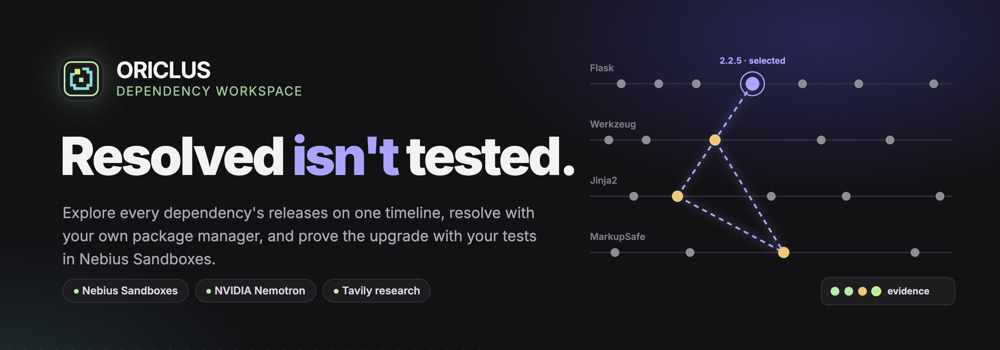
</p>

<div align="center">
  <h1>ORICLUS</h1>
  <p><strong>A dependency workspace that explores every release, resolves with your own package manager, and proves the upgrade with your tests in Nebius Sandboxes.</strong></p>
  <p><em><b>Ori</b>go + <b>cyclus</b>: trace a dependency change from its origin through every cycle of evidence.</em></p>
  <p>
    <a href="submission/submission-description.md"></a>
    <a href="https://nebiusglobalaihackathon.devpost.com/"></a>
    <a href="https://3t3h4y5hhclp2y2u3fwu5tfkky0mwnqm.lambda-url.us-east-1.on.aws/"></a>
  </p>
  <p>
    <a href="LICENSE"></a>
    
    
    
    
    
  </p>
  <p>
    
    
    
    
    
    
  </p>
  <p>
    <a href="submission/submission-description.md">Submission</a> ·
    <a href="submission/assets/film-hero.gif">Film</a> ·
    <a href="submission/assets/oriclus-architecture.gif">Architecture</a> ·
    <a href="PRODUCT.md">Product</a> ·
    <a href="DESIGN.md">Design</a> ·
    <a href="docs/evaluation-cases.md">Evaluation cases</a>
  </p>
  <p><sub>Explore the timeline → resolve with your package manager → test every combination in Sandboxes → verify a repair → decide</sub></p>
</div>

> [!TIP]
> **Try the hosted app:** [https://3t3h4y5hhclp2y2u3fwu5tfkky0mwnqm.lambda-url.us-east-1.on.aws/](https://3t3h4y5hhclp2y2u3fwu5tfkky0mwnqm.lambda-url.us-east-1.on.aws/)<br>
> Paste a public GitHub repository, explore its release timeline, resolve a release and run Sandbox tests. The hosted app accepts public GitHub projects only, shares a lifetime quota of 250 operations across all visitors, and allows up to four combinations per experiment. See [AWS hosted demo](#aws-hosted-demo).

> [!IMPORTANT]
> A version that **resolves** is not necessarily **tested**, and passing your selected tests does not guarantee compatibility. Oriclus is a local, single-operator workspace; its API controls code execution and is designed for loopback, not public hosting. Proposed patches are never applied to your project automatically.

<details>
<summary><kbd>Contents</kbd></summary>

- [At a glance](#-at-a-glance)
- [The problem](#the-problem)
- [The Oriclus loop](#the-oriclus-loop)
- [See the product](#see-the-product)
- [How it works](#how-it-works)
- [Feature inventory](#feature-inventory)
- [Who it helps](#who-it-helps)
- [Recorded verification](#recorded-verification)
- [Get started](#get-started)
- [Time machine](#time-machine)
- [What's New and metrics](#whats-new-and-metrics)
- [Supported inputs and limitations](#supported-inputs-and-limitations)
- [Data and security](#data-and-security)
- [AWS hosted demo](#aws-hosted-demo)
- [Development](#development)
- [Repository map](#repository-map)
- [License](#license)

</details>

## 🧭 At a glance

<table>
  <tr>
    <td width="25%" align="center"><strong>01 / EXPLORE</strong><br><br>Every direct and related dependency on one publication-date timeline, from GitHub or a local folder.</td>
    <td width="25%" align="center"><strong>02 / RESOLVE</strong><br><br>Your project's own package manager resolves a chosen release in a Nebius Sandbox. Labelled <em>not tested</em>.</td>
    <td width="25%" align="center"><strong>03 / EXPERIMENT</strong><br><br>Baseline first, then each combination in its own branch, three at a time, tests offline.</td>
    <td width="25%" align="center"><strong>04 / PROVE</strong><br><br>NVIDIA Nemotron investigates failures; patches are re-tested on a fresh branch and handed back for review.</td>
  </tr>
</table>

## The problem

`pip install -U flask` prints **Successfully installed flask-2.3.3**. Then the tests fail:

```text
AttributeError: 'Flask' object has no attribute 'before_first_request'
```

<p align="center">
  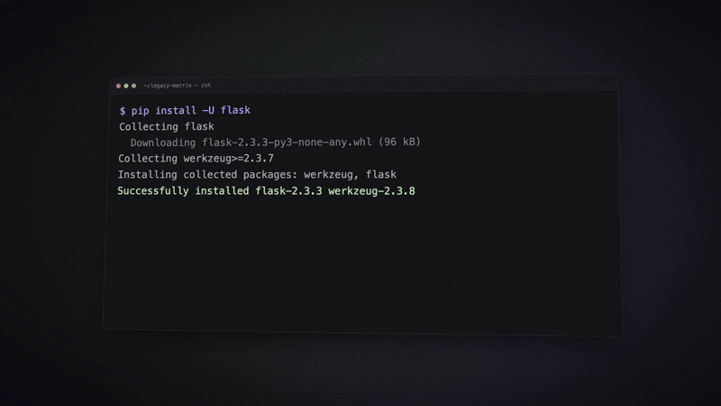
</p>

A package manager can tell you whether declared requirements resolve. It cannot tell you **which versions of your dependencies work together with your code and your tests**. Oriclus answers that question with recorded, isolated evidence.

## The Oriclus loop

<p align="center">
  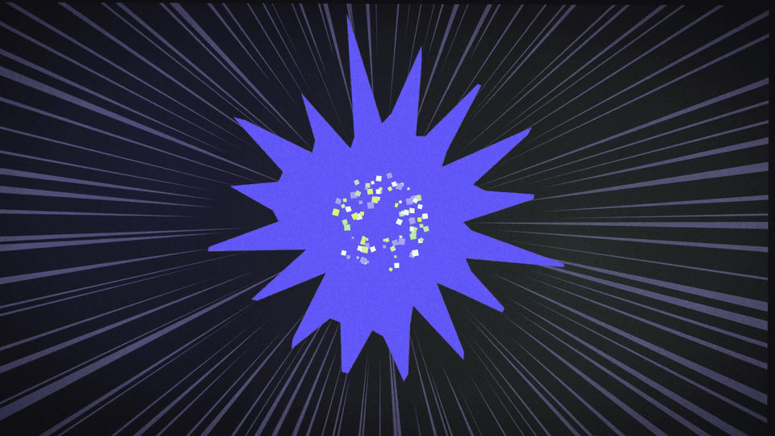
</p>

| Stage | What happens | What cannot happen silently |
| --- | --- | --- |
| **Explore** | Manifests are read at a recorded GitHub commit or from a local snapshot; release dates come from public registries. | Dates show availability, not compatibility. |
| **Resolve** | The native manager resolves a chosen release inside a Nebius Sandbox; declared links are drawn on the timeline. | A resolved set is never shown as a passing test. |
| **Experiment** | Up to five dependencies and 12 combinations; the baseline runs first, then up to three branches at once with networking disabled for tests. | A candidate is only passed or failed when the baseline passes. |
| **Investigate** | On a qualifying failure, Nemotron plans, runs offline tools and proposes a patch; every message and tool call is recorded. | The agent cannot mark its own patch as verified. |
| **Prove and decide** | The patch is re-tested on a fresh branch; **Review** focuses a combination on the timeline; fewest-change passing options are suggested. | Patches are never applied to your project. |

## See the product

<table>
  <tr>
    <td width="50%">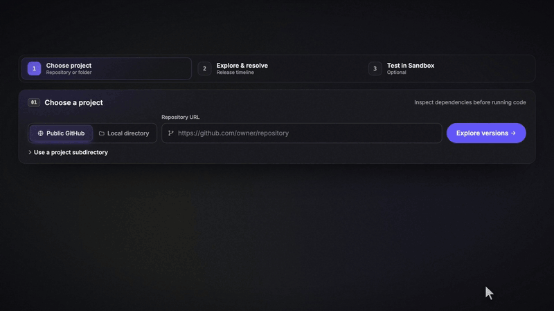<br><sub><strong>Choose a project.</strong> Public GitHub or a local folder, optionally one subdirectory.</sub></td>
    <td width="50%">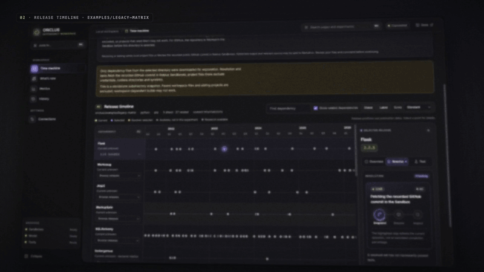<br><sub><strong>Resolve.</strong> Declared links from the resolver-selected releases. Resolved, not yet tested.</sub></td>
  </tr>
  <tr>
    <td width="50%">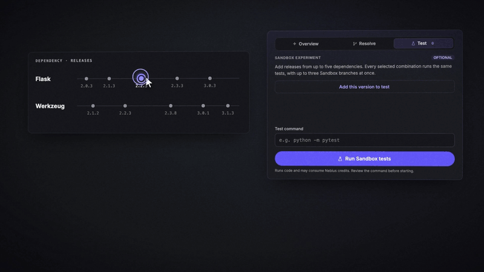<br><sub><strong>Experiment.</strong> 2 Flask × 2 Werkzeug releases = 4 combinations, one test command.</sub></td>
    <td width="50%">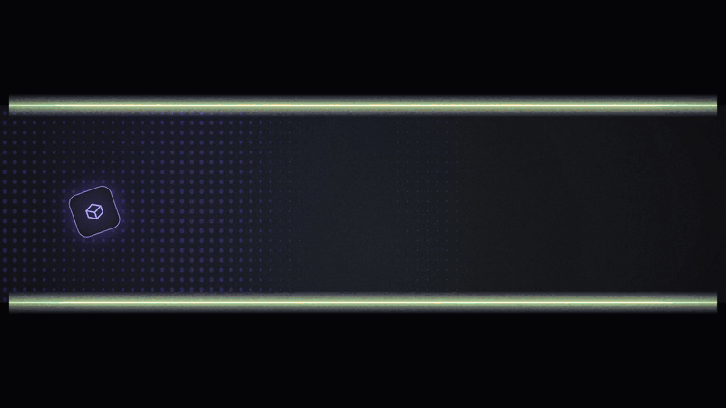<br><sub><strong>Sandbox branches.</strong> Baseline, then three branches at a time, tests offline.</sub></td>
  </tr>
  <tr>
    <td width="50%"><br><sub><strong>Investigate.</strong> Recorded tool calls, then “Flask 2.3.3 removed before_first_request.”</sub></td>
    <td width="50%">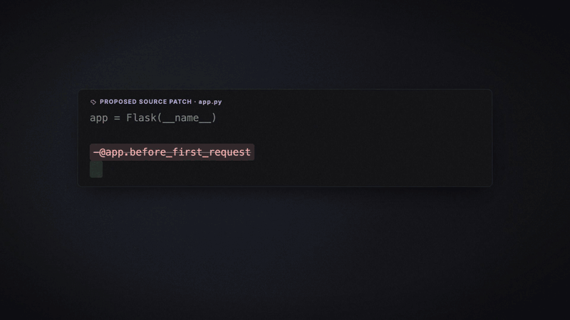<br><sub><strong>Verify.</strong> Re-tested on a fresh branch, then handed back for review.</sub></td>
  </tr>
  <tr>
    <td width="50%">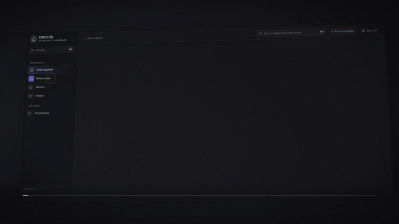<br><sub><strong>What's New.</strong> Tavily release research with cited sources, linked to the timeline.</sub></td>
    <td width="50%">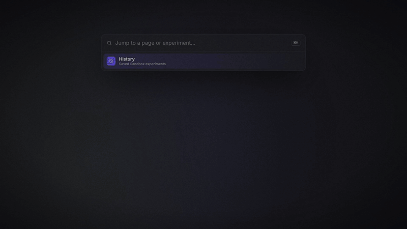<br><sub><strong>History.</strong> Reopen any experiment with its evidence; ⌘K jumps anywhere.</sub></td>
  </tr>
</table>

| Release timeline | Compare combinations | Verified patch |
| --- | --- | --- |
| 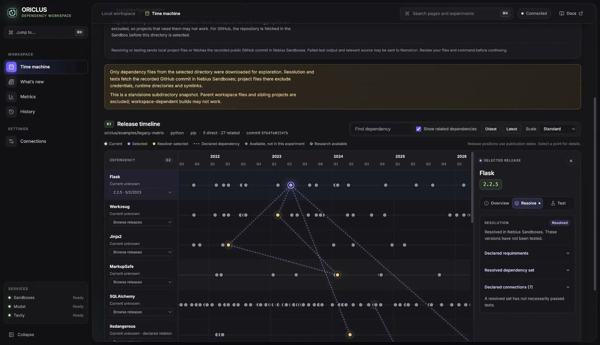 | 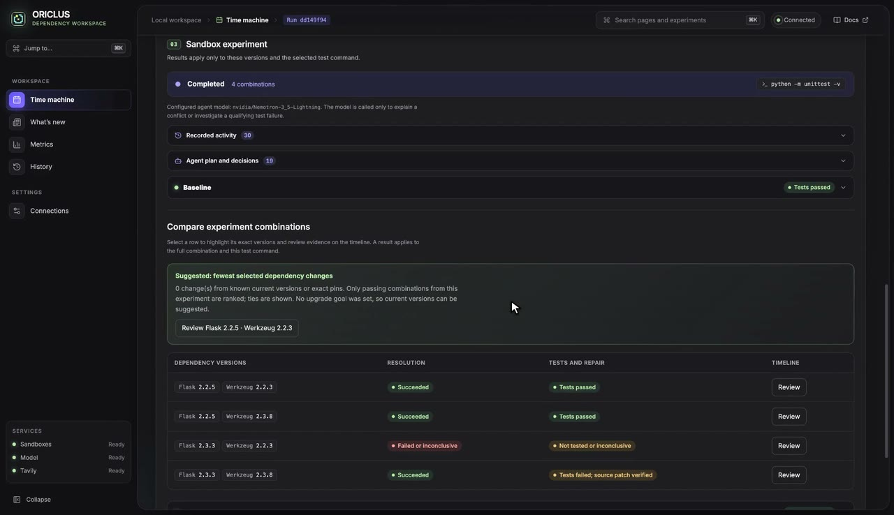 | 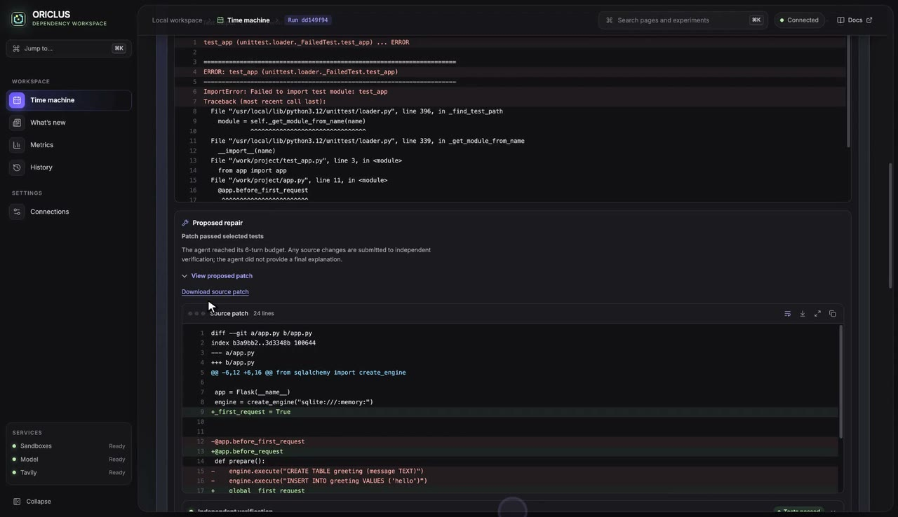 |
| **Sandbox experiment running** | **Agent plan and decisions** | **Cited release research** |
| 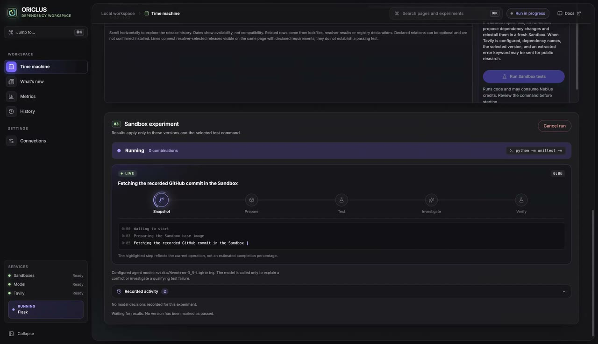 | 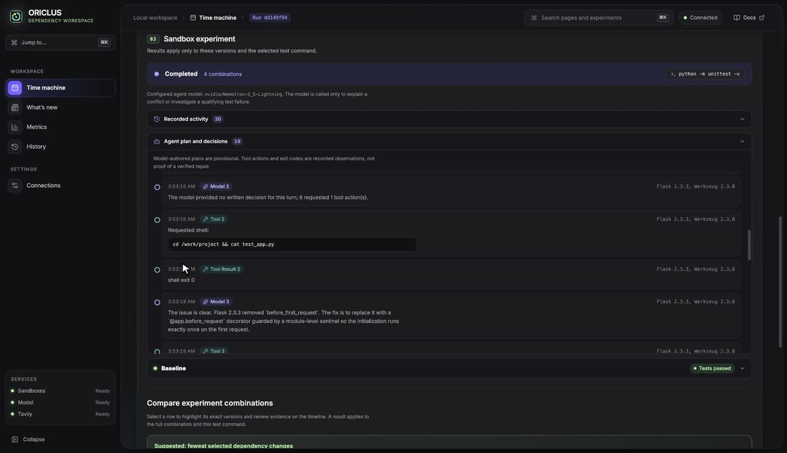 | 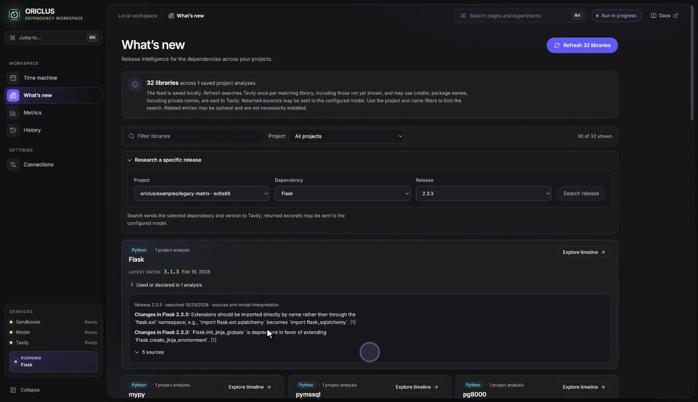 |

<sub>GIFs are cut from the project showreel, built from a screen recording of the real app on the constructed <code>examples/legacy-matrix</code> project. Screenshots are frames from that recording.</sub>

## How it works

<p align="center">
  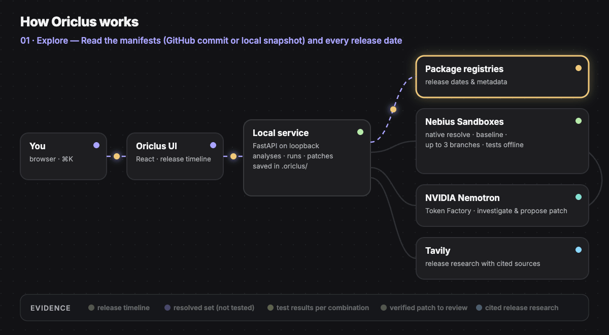
</p>

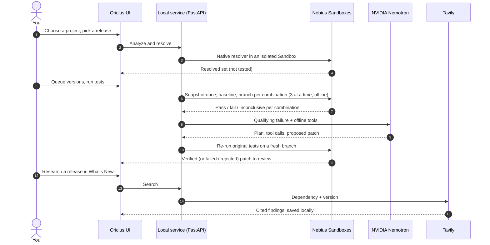

| Service | Runtime role |
| --- | --- |
| **Nebius Token Factory Sandboxes** | Snapshots, native installs, baselines, concurrent candidate branches, offline tests, patch verification, cancellation. |
| **NVIDIA Nemotron** (Token Factory) | Resolver-conflict explanations, failure investigation with recorded tool use, source and dependency-file patch proposals. |
| **Tavily** | User-initiated release research with citations for What's New and the timeline; may be supplied to the repair agent. |

## Feature inventory

| Feature | Available today | Scope and evidence |
| --- | --- | --- |
| Project discovery | Analyze a local project or a public GitHub repository, optionally selecting a standalone subdirectory. GitHub analyses record the default-branch commit. | Shared monorepo workspaces and private GitHub access are not fully supported. Local and Sandbox data limits are described below. |
| Shared release timeline | Show direct dependencies and related entries on a horizontally scrollable publication-date axis, with year and quarter/month navigation, zoom, search, paging, keyboard selection, and hover/focus details. | Release dates show availability, not compatibility. Releases without dates remain accessible in a list. Registry-declared relationships may be optional or uninstalled. |
| Native package-manager resolution | Select a release, resolve a candidate set in a Sandbox with the project's package manager, and inspect selected versions, requirement ranges, sources, and declared connections. | A resolved set is **not tested**. Missing metadata, conflicts, and inconclusive results remain visible. Connections are not proof of passing tests. |
| Multi-dependency experiments | Select up to five dependencies, up to five versions each, and at most 12 combinations; optionally require a selected version as the goal. Run the same selected command on a baseline and up to three independent candidate Sandbox branches concurrently. | Candidate pass/fail is recorded only when the baseline passes; resolution/install failures and timeouts remain inconclusive. Test execution is requested without Sandbox network access. |
| Show, guide, and use | Compare recorded combinations; select **Review** to focus their exact versions on the timeline and inspect the command, test results, and repairs. Available versions that did not participate remain distinct. | Results apply to the **entire combination**, test command, and environment. A completed run can suggest all tied passing options with the fewest selected-version changes when current versions or exact pins are known and the optional goal is met. No global optimum is implied. |
| Nemotron investigation and source repair | Show actual agent activity and recorded model plans, messages, tool actions and outcomes when available. Nemotron can investigate qualifying failures and propose a source patch; Oriclus independently reruns the original tests from a fresh candidate branch. | Plans and explanations are advisory. A verified repair passed only the recorded tests; failed, rejected and unavailable repairs stay visible. Rust source repair is disabled because tests can be embedded in source files. |
| Dependency-file repair | When enabled after an unsuccessful source repair, Nemotron can propose up to two changes to other direct dependencies. Oriclus validates them, generates allowed manifest/lockfile changes using the native manager, and independently reinstalls and retests. | Supports bounded forms for pip, uv, Poetry, npm, Yarn and pnpm; pip needs root `requirements.txt`. Complex project forms may be unavailable. Bun, Go and Cargo dependency-file repair is not supported. Proposals are never applied to the user's project automatically. |
| Patch review | Open recorded source or dependency patches, inspect their verification evidence, and download patches for manual review. | A patch that passed tests still needs review; validate it against your checkout before applying. |
| What's New and Tavily | Save a cross-project feed grouped by dependency; manually refresh filtered libraries with progress and cancellation, or research a particular release to find changes, useful features and migration considerations. Link sources and show saved release research on the timeline; relevant saved evidence may be supplied to the agent. | Public search results and model summaries are advisory and may be stale or incomplete. Refresh is user initiated, not an automatic monitor; package names may be sensitive. |
| Experiment history and progress | Show actual preparation, testing and agent stages, support cancellation, and reopen saved Time Machine results. History searches and filters the most recent 100 local experiments. | Older records may lack agent decisions or timing. Retired Docker rehearsal records are preserved separately in the legacy API, not mixed into Time Machine results. |
| Metrics | Visualize experiment completion, candidate outcomes, time to first conclusive result, and repair verification from local records, with denominators. | These are descriptive local metrics, not evidence of user productivity, accuracy, or superiority over another tool. Controlled evaluations and incomplete timing are handled explicitly. |
| Reproducible uv comparison | A script compares a bounded pip project and selected dependency versions with a uv-only Sandbox workflow and Oriclus, printing trials and denominators. | The uv-only path does not perform AI repair; repair verification is not applicable. Workflows and environments are not identical, no comparison file is written, and a repeatable multi-dependency uv/CI comparison remains open work. |

## Who it helps

- **Open-source contributors and maintainers:** investigate selected dependency changes and share test evidence and cited release information.
- **Individual developers:** explore upgrades and verify selected tests before changing their project.
- **Application teams:** reproduce an investigation in isolated Sandboxes and review proposed patches. Check the data-handling section before uploading company code.
- **Platform teams:** use it on individual projects today; organization-wide private-repository discovery, service impact maps, and access controls remain future work.

See [who benefits](docs/who-benefits.md) for examples and limitations.

## Recorded verification

These are bounded observations, not aggregate success rates or production-readiness claims. Commands, versions, caveats and local run IDs are documented in [evaluation cases](docs/evaluation-cases.md).

| Scenario | Observed result |
| --- | --- |
| Synthetic Flask/SQLAlchemy five-dependency matrix | Four combinations resolved with pip. The baseline combination passed; three upgrade combinations failed the original test, and each proposed Nemotron source patch passed independent verification. This is a constructed single-test example. |
| Real `microsoft/license-checker-webpack-plugin` npm matrix | Four combinations resolved. Two minimatch 3 combinations passed; two minimatch 9 combinations failed an **additional focused probe** after the original suite and passed after independent patch verification. The original 24 tests alone did not catch that incompatibility. |
| HTTPX/Starlette reproducer | HTTPX 0.28.0 exposed a failure. In one direct live dependency-repair evaluation, a Starlette 0.37.2 proposal passed a fresh independent test after a 0.37.0 proposal failed. A separate full-workflow evaluation did not produce a verified repair. |
| Bun, Go and Cargo examples | Each small constructed project passed its baseline and four two-dependency combinations in real Sandboxes. These runs did not demonstrate a failing candidate or AI repair for those managers. |
| Large and public repositories | Metabase root manifests and a 455 MiB prepared Sandbox source were inspected; its application tests were **not** run. Flask and FastAPI repositories passed focused probes, not their full original test suites. A standalone GitHub subdirectory example also produced both a passing and a failing candidate. |
| Automated and interface checks | The latest recorded check passed 69 backend tests, seven decision tests, Ruff, frontend formatting and production build. The timeline review flow was checked in a browser with saved Bun and JavaScript experiments; this did not start new Sandbox runs. |

Additional live small examples exercised native pip, uv, Poetry, npm, Yarn and pnpm resolution and tests, a resolver conflict, cancellation, and independent patch verification. Individual model outcomes vary; no maintainer feedback or reliable user-time savings have been established.

## Get started

Requirements: Python 3.12+, [uv](https://docs.astral.sh/uv/), Node.js 22.12+, npm, and access to Nebius Token Factory Sandboxes. Existing Docker history remains stored locally and available through the legacy API.

```sh
uv sync --frozen
npm ci
npm run build
cp .env.example .env
```

Set the following in `.env`, without committing it:

- `NEBIUS_API_KEY`, `NEBIUS_BASE_URL`, and `NEBIUS_MODEL`: Token Factory inference credentials, endpoint and NVIDIA model for explanations and repairs.
- `NEBIUS_PROJECT_ID`: project with Sandboxes access.
- `NEBIUS_SANDBOX_API_KEY`: Sandbox key, if different from `NEBIUS_API_KEY`; otherwise leave blank.
- `TAVILY_API_KEY`: optional for user-requested dependency research in What’s New.

Restart the service after changing credentials. Start the workspace:

```sh
uv run uvicorn server.app:app --host 127.0.0.1 --port 8787
```

Open http://127.0.0.1:8787. The API controls code execution and is designed for loopback, not public hosting.

## Time machine

Choose a public GitHub repository or an absolute local project directory. For GitHub, Oriclus records the default branch's commit and downloads only supported manifests in the selected directory for exploration. Resolution and experiments fetch that exact commit inside Nebius Sandboxes. For local projects, Oriclus snapshots files without modifying the source. It reads the manifests and fetches release metadata from public registries. The timeline aligns releases on publication dates; rows include direct dependencies and related entries from lockfiles, resolved candidates, and registry declarations for up to 25 exactly pinned direct dependencies. Up to 300 dependencies are loaded, searchable by name and displayed in pages of 20 timeline rows; connections are drawn only for endpoints on the current page. Registry declarations can include optional dependencies and do not prove installation; unpinned releases require resolution for additional related entries. Missing dates and metadata are shown as unknown. Choose a release to resolve a candidate set and inspect declared requirements. A resolution is not a test result.

To run an experiment, add releases from up to five dependencies, optionally choose a required release as the upgrade goal, review the test command, and choose **Run Sandbox tests**. Each dependency can have up to five selected releases and the Cartesian product is limited to 12 combinations. Oriclus prepares the project once, checks the baseline, and runs up to three independent candidate branches concurrently with the same selected tests offline. The comparison lists resolution, test, and repair outcomes per combination; a resolution failure or installation error is inconclusive, not a test failure. When current versions or exact manifest pins are known, the interface suggests qualifying combinations with the fewest changes to selected dependencies; this is not a global optimum. A passing baseline is required to classify a candidate as passed or failed.

After an experiment, choose **Review** beside a combination to focus the timeline on its exact versions and inspect the recorded test result, command, and any proposed repair. Versions appearing in an experiment are marked separately from other available releases; their outcomes apply to the full combination, not individual versions in isolation. A completed experiment may suggest all tied passing options with the fewest changes to selected dependencies, subject to the chosen goal and known current versions or exact manifest pins. A source or dependency repair is marked as requiring the verified patch, which can be reviewed and downloaded; Oriclus does not apply it to your project. Review the patch and use `git apply --check` against your own checkout before deciding whether to apply it. Missing current versions prevent this ranking. Results do not establish compatibility beyond the tests and environment recorded.

For a new failure, Nemotron may propose a source patch, checked against the original tests on a fresh candidate branch. If enabled and the source patch does not verify, Nemotron may propose up to two exact version changes to other direct dependencies. Oriclus validates those releases, keeps the primary version and explicit goal fixed, and uses the native manager to generate dependency files. It applies the resulting patch to a fresh baseline branch, independently installs it with network access, checks selected installed versions and that installation did not alter source or tests, then reruns the original tests offline. A failed test may trigger one additional proposal; each attempt remains visible. When configured, Tavily receives dependency names, the selected version and an extracted error keyword for public research. Unsupported manifests, invalid model proposals, installation failures and test failures remain visible. Both patches are reviewable proposals; neither is applied to the user's project. The dependency-file path currently supports direct selections and pip projects with a root `requirements.txt`; complex workspaces and other manifest forms may be unavailable.

Reproducible examples are available:

- `examples/timeline-python`: Flask, Werkzeug and MarkupSafe shown together; try MarkupSafe 2.0.1 to 2.1.5 with test command `python -m unittest -v`.
- `examples/timeline-node`: minimatch 3.1.2 to 9.0.5, test command `npm test`.
- `examples/httpx-starlette`: HTTPX 0.27.2 to 0.28.0 against Starlette 0.36.3, test command `python -m unittest -v`.
- `examples/unrepairable`: a negative control where the failing test itself imports a removed API; the repair must not change tests.
- `examples/legacy-matrix`: a deliberately constructed Flask/SQLAlchemy web application with five related dependencies and legacy API usage. It is not a production application.
- `examples/timeline-bun`: Bun example, `bun test`.
- `examples/timeline-go`: Go modules example, `go test ./...`.
- `examples/timeline-rust`: Cargo example, `cargo test --offline --locked`.

See [evaluation cases](docs/evaluation-cases.md) for a real JavaScript repository, a resolver conflict and actual results, including failures. The [demonstration script](docs/demo-script.md) separates recorded results from live execution. The [submission checklist](docs/submission-checklist.md) and [maintainer evaluation guide](docs/maintainer-evaluation.md) identify outstanding work without inventing user feedback. The repository is now public; the checklist's earlier private-visibility note is historical.

Some examples demonstrate breaking changes; others demonstrate passing combinations. They are not claims about every application using those packages. Resolution and tests use registry access and Sandbox compute and can consume credits.

## What's New and metrics

Analyze projects in Time Machine, then open **What’s New** to see a locally persisted feed grouped by distinct dependencies across saved project analyses. Filter by name or project, then choose **Refresh feed** to search all libraries matching the current filters once each; the progress indicator supports cancellation. You may also research a specific release. Only package names and selected versions are sent to Tavily; package names can themselves be sensitive. Search results are public, external sources and may be stale, incomplete or unrelated. The configured model may summarize them; citations link to returned sources, and summaries are advisory. Previously requested research for the same dependency and version can be supplied to the repair agent. No source proves a test passed. Search and inference may consume credits.

The Metrics page measures completed runs divided by terminal runs, median seconds from run creation to first conclusive candidate result, and verified repairs divided by recorded repair attempts. Labeled controlled evaluations are excluded from these aggregates. Active runs are excluded from completion; historical runs lacking timing are excluded from timing. The numbers describe local recorded runs, not product-wide accuracy or a comparison to uv. See [who benefits](docs/who-benefits.md).

## Supported inputs and limitations

Python discovery reads `pyproject.toml` or `requirements.txt`; `uv.lock` and `poetry.lock` select their respective managers, otherwise pip is used. JavaScript/TypeScript discovery reads `package.json`; Bun is selected by `bun.lock`, `bun.lockb` or a Bun `packageManager` field, pnpm and Yarn by their lockfiles, otherwise npm is used. Bun's installed versions are read through native resolution rather than from its lockfile during initial discovery. Experiments use an `oven/bun:1` image; the exact Bun version requested by a project's `packageManager` field is not enforced.

Go modules (`go.mod`) and Rust Cargo (`Cargo.toml`, optionally `Cargo.lock`) are experimental. Standard Go `require` entries and direct Cargo dependencies are discoverable; Cargo path, Git, workspace, alias and custom-registry dependencies are skipped with a warning. Go releases beyond the 30 most recent dated entries remain accessible without a date. Cargo candidate selection is limited to direct dependencies. The Sandbox images use Go 1.24 with automatic toolchain downloads disabled and the `rust:1` image. Native resolution and offline tests have been exercised with small examples; broad compatibility, workspaces, custom registries and toolchain requirements remain unverified. Dependency-file repair does not support Bun, Go or Cargo, and Rust source repair is disabled because tests can be embedded in source files.

For a monorepo, use **Use a project subdirectory** to inspect and test one standalone Python, JavaScript, Go or Rust project. Parent files, sibling packages and shared workspace configuration are excluded from the saved project, so projects depending on them may fail; selecting a directory is not full workspace support. GitHub exploration reads the selected directory's manifests at the recorded commit; Sandbox preparation temporarily fetches the full repository before retaining the selected directory. Local projects snapshot only that directory, subject to the limits below.

Native resolver and install commands run in isolated Sandbox copies. Check UI warnings for unsupported requirements, dynamic metadata, duplicate package instances and incomplete lockfile details. Complex workspaces, private registries, package-manager-specific configuration, external services and unusual scripts may require additional configuration. Release history and selected tests are bounded: Oriclus does not infer outcomes for untested releases or claim the globally first breaking version. It does not automatically identify the first observed breaking release across a tested range.

## Data and security

For public GitHub exploration, Oriclus saves only supported manifests from the chosen directory at the recorded commit. GitHub API rate limits apply and each manifest is limited to 20 MB. When resolving or running tests, the Sandbox fetches that commit and excludes `.env*`, common credential directories/files, private-key extensions, Git metadata, dependency directories, generated output and symlinks before saving the project image. A commit that is no longer available causes preparation to fail rather than silently using another version.

For local projects, Oriclus creates a snapshot in `.oriclus/timeline/` with the same exclusions. Local snapshots remain limited to 100 MB or 10,000 files and the compressed Sandbox upload is limited to 50 MB. Exclusions are best effort, not a secret scanner. Review your source before use: other sensitive files may remain. Selected test output and source context requested by the agent can be sent to the configured Nebius inference model. Consult your organization's policies before uploading private data.

Dependency installation and resolution require network access and may execute project or package code. Tests, model tool operations and patch verification explicitly request no Sandbox network access. No model or Sandbox API credentials are passed to guest commands. Nebius controls image, upload, operation and log retention; a disposable operation does not guarantee that every service record is deleted. See [Sandbox security and data handling](https://docs.tokenfactory.nebius.com/sandboxes/operate/security-and-data-handling). Use trusted inputs and review commands and patches.

`.oriclus/` contains local analyses, runs, history and artifacts and is excluded from Git. The retired Docker rehearsal interface is no longer shown; its saved records remain available through `GET /api/runs` and `GET /api/runs/{run_id}` on the local service. Old `?run=...` links redirect to Time Machine History. Its original history and verification are preserved in [docs/legacy-rehearsal.md](docs/legacy-rehearsal.md).

## AWS hosted demo

**Hosted app:** [https://3t3h4y5hhclp2y2u3fwu5tfkky0mwnqm.lambda-url.us-east-1.on.aws/](https://3t3h4y5hhclp2y2u3fwu5tfkky0mwnqm.lambda-url.us-east-1.on.aws/)

The optional public demo uses an AWS Lambda function URL for the app, an SQS-backed Lambda worker for background jobs, private S3 storage for per-browser checkpoints, DynamoDB for the shared lifetime operation counter, and an encrypted Systems Manager parameter for the host's Nebius and Tavily credentials. These services are usage based but are **not guaranteed to be free**. Nebius and Tavily usage is billed separately. The public endpoint has no sign-in: anyone can consume the deployment's shared quota.

The lifetime quota is **250 shared operations** across all visitors and persists in DynamoDB across deployments. Starting an analysis, resolution, experiment, release research or feed refresh consumes one operation, including failures after hosted input validation. Page views and progress polling do not consume the operation counter but can incur AWS request costs. Hosted experiments allow at most four combinations; feed refresh requires filtering to at most five libraries; model repair is limited to six turns. A single operation can still make multiple Sandbox, model or Tavily calls, so the counter is **not a monetary spending limit**.

The hosted service accepts only public GitHub projects. Browser sessions receive a signed, HTTP-only cookie, and saved data is separated by session. Clearing the cookie loses access to that browser's hosted history; anyone with a copied session cookie can access that session. Do not use the public demo for sensitive projects. Local directories and local history stay on your computer and are not uploaded during deployment. Workers are limited to two concurrent jobs and 15 minutes each; longer jobs stop with partial evidence. The AWS account's Lambda concurrency quota is shared with its other functions.

Deploy using your own AWS account and locally configured `.env`:

```sh
uv sync --frozen
uv run python deploy/aws/deploy.py --profile YOUR_AWS_PROFILE --region us-east-1
```

The script creates uniquely named AWS resources and records their identifiers in `.oriclus/aws-deployment.json`; it does not print or commit credentials. Redeployment keeps the session key and quota table. To stop ongoing costs, delete the deployment's CloudFormation stack, then separately delete its S3 bucket and encrypted Systems Manager parameter if you no longer need the saved history. Deleting only the Lambda function does **not** delete the S3 data, queue, quota table, logs, or parameter. Check the saved resource identifiers before deleting anything.

## Development

```sh
uv run python -m unittest discover -s tests -v
uv run ruff check server tests scripts
uv run ruff format --check server tests scripts
npm run format:check
npm run test:frontend
npm run build
```

For local frontend work, run `npm run dev` alongside the API. Live Sandbox and inference tests require valid credentials, network access and credits. They are not a substitute for unit tests.

### Repeat a uv comparison

Run from the repository root:

```sh
uv run python -m scripts.benchmark_uv --trials 1
```

The default compares the bundled Python example, MarkupSafe 2.0.1 and 2.1.5, and `python -m unittest -v`. Use `--project`, `--package`, `--versions`, and `--test` for another supported pip project with a `requirements.txt` file; `--trials` accepts 1–5. Both paths use separate Nebius Sandbox branches from the same project and run the same candidate constraints and tests. The uv-only path installs with uv and does not perform an AI repair; Oriclus uses the project's pip resolver, records results and can run repair verification. Resolver choices, caching, network, image preparation and other work can differ, so matching outcomes do not imply identical environments or equal effort. The script prints trial data and denominators to the console without writing a comparison file. Oriclus experiment records are still saved in the local `.oriclus/` history. Sandbox and model calls can consume credits.

Release-specific research appears on the main timeline as an outlined marker and is shown with citations in the selected release panel. General searches without a specific version do not imply relevance to an individual release. New experiments record a provisional model-authored plan and the public model messages, tool requests, and tool outcomes; older runs cannot reconstruct decisions they did not record. These are saved locally with the run and can include code or commands, so protect local history as project data. The plan is advisory and may change as the agent learns from tool results.

## Repository map

| Path | What lives there |
| --- | --- |
| `web/src/` | React workspace: timeline, inspector, experiments, What's New, History, Metrics, ⌘K palette. |
| `server/` | FastAPI service: analysis, resolution, Sandbox execution, agent and repair, research feed, metrics. |
| `deploy/aws/` | Optional hosted demo (Lambda, SQS, S3, DynamoDB) and its deployment script. |
| `examples/` | Reproducible example projects, including `legacy-matrix` and the `timeline-*` examples. |
| `tests/` | Backend unit tests and frontend decision tests. |
| `docs/` | Demo script, evaluation cases, maintainer evaluation, submission checklist. |
| `submission/` | Submission description, banner, GIFs, architecture animation and screenshots. |

## License

Oriclus is released under the [Apache License 2.0](LICENSE). Additional MIT license text for project testing material is in [`LICENSES/`](LICENSES/project-testing-MIT.txt).
