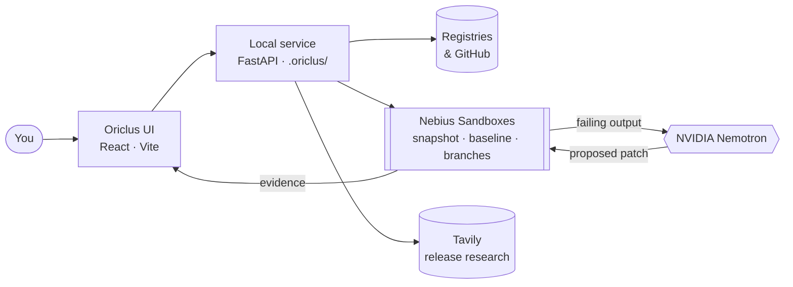

<p align="center">
  
</p>

# Oriclus

## Resolved isn't tested.

**Oriclus** is a dependency workspace for developers who are about to upgrade. It lines up every dependency's releases on **one shared timeline**, lets your **own package manager** resolve a candidate in a **Nebius Sandbox**, then runs **your tests** against every combination you choose, in parallel, isolated branches. When a combination fails, **NVIDIA Nemotron** investigates inside the Sandbox and proposes a patch, and Oriclus re-runs your original tests on a fresh branch to verify it. Nothing is ever applied to your project for you.

<p align="center">
  <a href="https://github.com/azharizz/oriclus"></a>
  
  
  
  <a href="https://3t3h4y5hhclp2y2u3fwu5tfkky0mwnqm.lambda-url.us-east-1.on.aws/"></a>
</p>

<p align="center"><strong>🚀 Try it live:</strong> <a href="https://3t3h4y5hhclp2y2u3fwu5tfkky0mwnqm.lambda-url.us-east-1.on.aws/">https://3t3h4y5hhclp2y2u3fwu5tfkky0mwnqm.lambda-url.us-east-1.on.aws/</a><br><sub>Public GitHub projects only · shared lifetime quota of 250 operations · up to four combinations per experiment</sub></p>

## Inspiration

You bump one version. `pip install -U flask` says **Successfully installed flask-2.3.3**. Then your tests disagree:

```text
AttributeError: 'Flask' object has no attribute 'before_first_request'
```

<p align="center">
  
</p>

A package manager answers one question very well: *can these declared requirements be satisfied?* It cannot answer the one you actually care about: **which versions of my dependencies work with my code and my tests?** Today that answer costs an afternoon of branches, rollbacks and changelog reading, and the evidence disappears with the terminal.

We wanted a place where an upgrade is treated like a hypothesis: explored on a timeline, resolved honestly, tested in isolation, repaired with evidence, and remembered.

## What it does

<p align="center">
  
</p>

| Oriclus capability | What it does | Why it matters |
| --- | --- | --- |
| **1 · Explore** | Point it at a public GitHub repo or a local folder (optionally one subdirectory). Every direct and related dependency appears on one publication-date timeline: zoom, search, page, jump to any release. | You see what shipped, and when, for everything at once. |
| **2 · Resolve** | Pick a release. The project's **native** package manager (pip, uv, Poetry, npm, Yarn, pnpm, Bun; Go and Cargo experimental) resolves it inside a Nebius Sandbox. Declared links are drawn on the timeline. | A real resolver answer, clearly labelled **not tested**. |
| **3 · Experiment** | Queue releases from up to five dependencies (up to 12 combinations). Oriclus snapshots the project once, checks the baseline, then runs each combination in its own branch, three at a time, **tests offline**. | Every combination gets the same tests in a clean, isolated environment. |
| **4 · Compare and guide** | Each combination shows resolution, test and repair outcomes. **Review** focuses its exact versions on the timeline; a completed run suggests the passing options with the fewest changes. | Decide from evidence, not from a changelog. |
| **5 · Investigate and repair** | On a qualifying failure, NVIDIA Nemotron plans, reads code and runs commands in the Sandbox, then proposes a source or dependency-file patch. Oriclus re-runs the original tests on a **fresh branch**. | A fix you can review and download, with proof it passed your selected tests. |
| **6 · Research and revisit** | What's New keeps a feed of every library across your projects, with Tavily release research and cited sources. History reopens any experiment; ⌘K jumps anywhere. | The evidence stays, and so does the context. |

## Product walkthrough

Every clip below is cut from our showreel, which is built from a screen recording of the real app running the constructed `examples/legacy-matrix` project (Flask, Werkzeug, Jinja2, MarkupSafe, SQLAlchemy).

<table>
  <tr>
    <td width="50%"><br><sub><strong>Explore.</strong> Every dependency on one shared release timeline. Travel back, jump forward.</sub></td>
    <td width="50%"><br><sub><strong>Choose a project.</strong> Public GitHub or a local folder, an optional subdirectory, then <em>Explore versions</em>.</sub></td>
  </tr>
  <tr>
    <td width="50%"><br><sub><strong>Resolve.</strong> Flask 2.2.5 resolved by pip in a Nebius Sandbox. The lines are declared links. Resolved? Yes. Tested? Not yet.</sub></td>
    <td width="50%"><br><sub><strong>Experiment.</strong> Flask 2.2.5 / 2.3.3 × Werkzeug 2.2.3 / 2.3.8 = 4 combinations, one test command.</sub></td>
  </tr>
  <tr>
    <td width="50%"><br><sub><strong>The real run.</strong> The recorded <em>Run Sandbox tests</em> click and the live <em>Running</em> panel, with the recorded result.</sub></td>
    <td width="50%"><br><sub><strong>Inside the Sandbox.</strong> One snapshot, a baseline check, then branches, three at a time, tests offline.</sub></td>
  </tr>
  <tr>
    <td width="50%"><br><sub><strong>Compare.</strong> Two combinations pass, one stays inconclusive, Flask 2.3.3 with Werkzeug 2.3.8 fails.</sub></td>
    <td width="50%"><br><sub><strong>Investigate.</strong> The real agent decisions: tool calls in the Sandbox, then “Flask 2.3.3 removed before_first_request.”</sub></td>
  </tr>
  <tr>
    <td width="50%"><br><sub><strong>Verify.</strong> The patch is re-tested on a fresh branch: verified, and never applied for you.</sub></td>
    <td width="50%"><br><sub><strong>Research.</strong> Pick a release, search with Tavily, read cited findings, saved and linked to the timeline.</sub></td>
  </tr>
</table>

<p align="center">
  <br>
  <sub><strong>Revisit.</strong> ⌘K → History → reopen the experiment with every result intact.</sub>
</p>

### Real screens

| Choose a project | Release timeline and resolution | Queue versions to test |
| --- | --- | --- |
|  |  |  |

| Sandbox experiment running | Compare combinations | Agent plan and decisions |
| --- | --- | --- |
|  |  |  |

| Verified source patch | What's New feed | Cited release research |
| --- | --- | --- |
|  |  |  |

## How the agent works

<p align="center">
  
</p>

1. **Snapshot once.** Oriclus prepares the project (a recorded GitHub commit or a local snapshot with credential, dependency and Git exclusions) in a Nebius Sandbox and checks the **baseline** with your test command.
2. **Branch per combination.** Each selected combination installs with the native package manager in its own branch, up to three concurrently. Tests and verification **request networking disabled**.
3. **Investigate a qualifying failure.** NVIDIA Nemotron gets the failing output and a bounded set of offline tools. It writes a provisional plan, reads files and runs commands; every model message, tool request and exit code is recorded.
4. **Propose, then prove.** A proposed source patch (or, if enabled, a bounded dependency-file change produced by the native manager) is applied to a **fresh branch** and the original tests are re-run. Only then is it marked verified.
5. **Hand it back.** The patch is shown with its verification evidence and can be downloaded. Oriclus never applies it to your project.

| The agent can | The agent cannot |
| --- | --- |
| Read code and run offline commands inside an isolated Sandbox branch. | Touch your checkout or your credentials; tests and its tools request networking disabled. |
| Propose a source patch or up to two dependency-version changes. | Mark its own patch as passing: only an independent re-run can. |
| Use saved Tavily research for the same dependency and release as evidence. | Change the tests, configuration or the primary version under test. |

## How Nebius, Nemotron and Tavily are used at runtime

| Service | Runtime role in Oriclus |
| --- | --- |
| **Nebius Token Factory Sandboxes** | Isolated, branchable execution for every resolution, baseline, candidate and verification. Project snapshots, native installs with network, tests with networking disabled, concurrent branches, cancellation. |
| **NVIDIA Nemotron** (via Nebius Token Factory, `nvidia/Nemotron-3_5-Lightning`) | Explains resolver conflicts, investigates qualifying test failures with recorded tool use, and proposes source or dependency-file patches. Advisory until verified. |
| **Tavily** | User-initiated release research for What's New and a chosen release: public sources, optional model summaries with citations, linked on the timeline and available to the repair agent. |
| **Public registries and GitHub** | Release dates and metadata for the timeline; manifests at a recorded commit. |

## A real result, end to end

On the constructed `examples/legacy-matrix` project, with `python -m unittest -v`:

| Combination | Resolution | Tests and repair |
| --- | --- | --- |
| Flask 2.2.5 · Werkzeug 2.2.3 | ✅ Succeeded | ✅ Tests passed |
| Flask 2.2.5 · Werkzeug 2.3.8 | ✅ Succeeded | ✅ Tests passed |
| Flask 2.3.3 · Werkzeug 2.2.3 | ⚠️ Failed or inconclusive | ⚠️ Not tested or inconclusive |
| Flask 2.3.3 · Werkzeug 2.3.8 | ✅ Succeeded | ❌ Tests failed → 🔧 source patch verified on a fresh branch |

The baseline passed. Nemotron found that Flask 2.3.3 removed `before_first_request` and proposed replacing it with `before_request` guarded by a module-level sentinel; the independent re-run passed the selected tests. Oriclus then suggested the passing combinations with the fewest changes.

## How we built it



| Technology | Role in Oriclus |
| --- | --- |
| **React 19.3 · Vite 8.3 · TypeScript 7.0** | The workspace: release timeline, inspector, experiments, comparison, What's New, History, Metrics. |
| **TanStack Query · Lucide** | Live run polling and progress; consistent outline icons. |
| **Python 3.12 · FastAPI · uv** | The local service: analyses, resolution, experiments, agent loop, research feed. |
| **Nebius Token Factory Sandboxes** (`contree-sdk`) | Branchable, isolated execution for every install and test. |
| **NVIDIA Nemotron** | Investigation and repair with recorded plans, tool calls and outcomes. |
| **Tavily** | Release research with citations. |
| **AWS Lambda · SQS · S3 · DynamoDB** | The optional hosted demo with a shared, persistent operation quota. |

## Challenges we ran into

- **Real isolation without real cost.** Snapshotting once and branching per combination keeps experiments fast and identical, while three-at-a-time concurrency and a 12-combination cap keep Sandbox credits predictable.
- **An agent that can't grade itself.** Nemotron's patches are only marked verified after an independent re-run of the original tests on a fresh branch; failed, rejected and unavailable repairs stay visible.
- **Many package managers, one timeline.** pip, uv, Poetry, npm, Yarn, pnpm and Bun each resolve differently; Oriclus always defers to the native manager and labels unknowns instead of guessing.

## Accomplishments we're proud of

<p align="center">
  
</p>

- A full loop from *"which version?"* to a verified, reviewable patch, all inside isolated Nebius Sandboxes.
- Real Sandbox evaluations across pip, uv, Poetry, npm, Yarn and pnpm, plus passing Bun, Go and Cargo examples; a real JavaScript repository matrix with an independently verified repair.
- Agent transparency: every recorded plan, model message, tool request and exit code is visible and saved with the run.
- A 2:58 showreel built from the real recordings, with an original orchestral score and a generated narrator.

## What we learned

Most of the value is in the boundaries. A resolver answer, a test result, a model suggestion and a verified patch are four different kinds of evidence, and the product is only trustworthy if it never blurs them. Giving the agent real tools in a real Sandbox made it useful; refusing to let it grade its own work made it believable.

## What's next

- One-click "bump these together" for many dependencies in a single combination, keeping the 12-combination cost guard.
- Private repository access, full monorepo workspaces and custom registries.
- A repeatable multi-dependency comparison against CI and uv, and real maintainer feedback.
- Scheduled What's New refresh with alerts for releases that touch your pinned versions.

## Honest limits

- **A pass is evidence for that command and environment only**, not general compatibility. Oriclus does not infer outcomes for untested releases or identify the first breaking release automatically.
- **Go and Cargo are experimental**; dependency-file repair does not support Bun, Go or Cargo, and Rust source repair is disabled.

## Try it

- **Source:** [github.com/azharizz/oriclus](https://github.com/azharizz/oriclus)
- **Hosted app:** [https://3t3h4y5hhclp2y2u3fwu5tfkky0mwnqm.lambda-url.us-east-1.on.aws/](https://3t3h4y5hhclp2y2u3fwu5tfkky0mwnqm.lambda-url.us-east-1.on.aws/) (public GitHub projects only; a shared lifetime quota of 250 operations, up to four combinations per experiment)
- **Run it locally:** `uv sync --frozen && npm ci && npm run build && cp .env.example .env`, add your Nebius (and optional Tavily) keys, then `uv run uvicorn server.app:app --host 127.0.0.1 --port 8787` and open http://127.0.0.1:8787
- **Product decisions:** [PRODUCT.md](https://github.com/azharizz/oriclus/blob/main/PRODUCT.md) · **Design:** [DESIGN.md](https://github.com/azharizz/oriclus/blob/main/DESIGN.md) · **Evaluation cases:** [docs/evaluation-cases.md](https://github.com/azharizz/oriclus/blob/main/docs/evaluation-cases.md)
